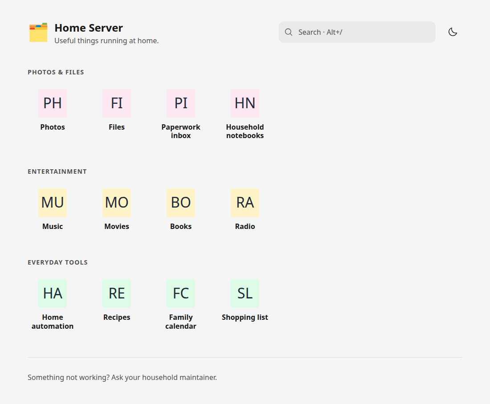

# 🗂️ Directory

A bare bones directory page for your homelab.



Directory does one thing and nothing more. That's the point. Sort of.

No plugins. No database. No baloney.

## Get started

Let's assume you have docker compose (or you are getting it RIGHT NOW or you know
your way around the docker cli or you have your own tricks up your sleeve...)

Run the following commands in your favorite terminal:

```sh
mkdir directory
cd directory
mkdir config public
curl -fsSLo compose.yaml https://git.eleith.com/eleith/directory/raw/branch/main/docs/compose.yaml
curl -fsSLo config/directory.yaml https://git.eleith.com/eleith/directory/raw/branch/main/docs/directory.example.yaml
docker compose up -d
```

Meditate for 5s or 1m depending on your internet connection, cpu speed or room
temperature.

Open http://localhost:3000.

Rejoice.

Edit `config/directory.yaml` to start adding your links.

## Documentation

- [Configuration](docs/config.md)
- [Deployment](docs/deployment.md)
- [Development](docs/development.md)
